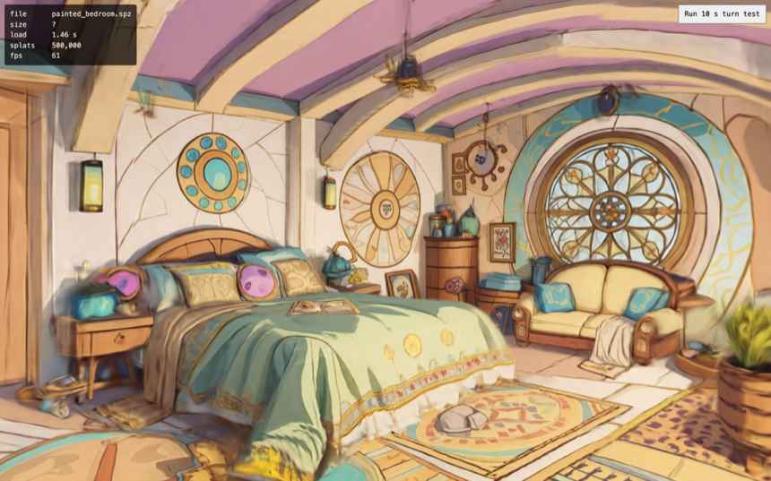

# language-room

**Problem.** Speaking practice needs a situation to speak in and a partner who keeps to the learner's level. A tutor that marks a correct sentence as wrong teaches the wrong thing, so correctness is the main risk.

**Idea.** Walk into a generated place (a Lisbon café, a Tokyo ticket window) and talk to the person behind the counter. The conversation is the lesson, the place supplies context, and a recap lists the phrases used, the mistakes and three phrases to practise.

**Built.** A working first build of the one-scenario loop, run only on this Mac with a local model. It has a spec, an implementation plan, a phase 0 viewer spike (three.js and Spark) that loaded a 500k-splat sample room in about 2 seconds at 60 fps in Chrome, and an app: library, brief, conversation page with the scene viewer, recap, and a scenario authoring form. Speech to text is local Whisper, the character and the correction checker run on a local Gemma model, and the correction gate keeps unverified corrections from the learner. The Lisbon café scene file does not exist yet (the Marble export is a paid step), so the scene path has run only with a sample room. No fluent speaker has reviewed the café scenario, and Safari is not measured. 35 commits on 4 days between Oct 27 and Nov 21, 2026. The state against the 14 acceptance criteria is in [docs/acceptance-2026-11-21.md](docs/acceptance-2026-11-21.md).

**Decision.** Each place is generated once with World Labs Marble and exported, instead of generated live with Genie 3 or Runway GWM Worlds 2. Neither has a public API and live worlds drift and forget, at the cost that the scene cannot react to the conversation.



Status: first build runs locally, not reviewed by a fluent speaker, not deployed. Live URL: none. Started 2026-10-27.

**TL;DR**

- Practise a language by walking into a generated place (a Lisbon café, a Tokyo ticket window, a Paris pharmacy) and talking to the person behind the counter.
- The conversation is the lesson: a character voiced by an LLM keeps to your level and corrects gently. The place supplies context and memory cues.
- After the scene you get a short recap: phrases you used, your mistakes, and three phrases to practise next.

## What it is

A web app for adult self-learners, and for teachers who want a ready-made scene for a class. The core content unit is a **scenario**: one place, one character, one goal ("order a coffee and ask for the bill") and one target level (CEFR A1 to B2).

The first build covers one language (European Portuguese) and one scenario (a Lisbon café). Everything else waits for that loop to work.

## How a session works

1. Pick a scenario and read its brief: place, goal, level, five or six useful words.
2. Walk in. The scene loads in the browser and the character greets you.
3. Talk. You speak, you see what the app heard and confirm it, the character answers in voice and text.
4. Gentle corrections appear next to your lines, only after a second check has agreed with them.
5. The scene ends when you reach the goal or leave.
6. Read the recap: phrases used, mistakes with the corrected form, three phrases to practise next.

## How it works

```
 Scenario file (JSON)
   place + character + goal + level + hotspots + signage
        |
        |-----------------------> Scene viewer
        |                         Marble scene (exported once, kept local)
        |                         three.js + Spark, optional WebXR on Quest 3
        |
        '-----------------------> Conversation loop
                                  mic -> speech-to-text -> learner confirms transcript
                                       -> LLM character reply -> text-to-speech
                                  in parallel: analyzer -> reviewer -> verified corrections
                                       |
                                       v
                                  Session log -> Recap
```

- **The place.** World Labs Marble builds a persistent 3D scene from text, an image or a video. Each place is generated once, exported as a Gaussian splat (SPZ or PLY), and loaded in the browser. Genie 3 and Runway GWM Worlds 2 have no public API, so they are not used.
- **The voice.** Speech-to-text, an LLM character and text-to-speech, each behind an adapter so providers can be swapped. Paid providers stay off until the owner approves them. A local model on a home GPU box is the $0 fallback.
- **Correctness.** Every correction goes through a second review pass before the learner sees it. A correction the reviewer cannot confirm is never shown as fact.
- **Scenery text.** World models render text poorly, so signs and menus in a generated scene may contain wrong or invented words. The app never teaches from text inside the scene. Signs a learner should read are authored in the scenario file and drawn as overlays.

## Stack

- TypeScript, Vite, Vitest.
- three.js and the Spark splat renderer (by World Labs) for the scene.
- A small local Node server that holds API keys and proxies LLM calls. Keys never reach the browser.
- Provider options (recommended first): speech-to-text, local Whisper-class model or browser speech recognition, then hosted; LLM, Claude API or a local model; text-to-speech, browser voices, a local open model, then hosted. Details and costs are in the spec.

## Run it locally

Needs Node, a local model server and whisper.cpp. Nothing here calls a paid service: `PAID_PROVIDERS` stays `off`.

```
npm install
cp .env.example .env     # key names only, no values are needed for the free path
npm run server           # local proxy, port 5188
npm run dev              # Vite dev server, port 5187, proxies /api to 5188
```

Open http://localhost:5187.

What the server expects (names are in `.env.example`; the defaults are the ones the build was run with):

- Local model: an OpenAI-compatible server at `LOCAL_LLM_URL` (default `http://127.0.0.1:11434/v1`). `LOCAL_LLM_MODEL` is optional; the proxy reads the model name from the server. The build was run on `gemma-4-E4B-it-Q8_0.gguf` under llama-server.
- Speech to text: `whisper-cli` (`WHISPER_CLI`) with the model file `WHISPER_MODEL` (default `~/whisper.cpp/models/ggml-large-v3-turbo.bin`) and `ffmpeg` (`FFMPEG`). The browser microphone sends audio to the proxy, which runs Whisper on the machine.
- Speech output: browser voices. European Portuguese needs a pt-PT voice installed in the browser or system.

Links worth knowing. The first two work only in a development build, because the café scenario is unlisted until a fluent speaker signs it:

- `/s/lisbon-cafe-pt/play`: the conversation page. The café scenario has no reviewer entry, so the library does not list it. Open it by this link or from the "Development only" list.
- `/s/lisbon-cafe-pt/play?scene=sample`: loads a sample room in place of the café scene and labels it "Sample room, not the café". Add `&place=1` for the panel that prints coordinates picked by clicking.
- `/author`: the scenario authoring form, with import and export. It is in every build.

Checks and evaluation:

```
npm test                    # unit tests
npm run typecheck
npm run lint
npm run build
npm run validate:scenarios  # validates files in scenarios/
npm run eval                # gold set through analyzer and reviewer, local model, about 5 minutes
npm run eval:stt:synthetic  # local Whisper on synthetic voice sentences
npm run steps:live          # goal-step judge against the local model
npm run session:synthetic   # scripted learner through the whole café scenario, writes a review sheet
npm run check:level         # words per sentence of the character lines
```

## What is not done

The full list, with evidence per acceptance criterion, is in [docs/acceptance-2026-11-21.md](docs/acceptance-2026-11-21.md). In short:

- The café scene file: the paid Marble export (plan tasks 3 and 4) has not been run.
- A fluent European Portuguese speaker has not reviewed the scenario, the gold set, the speech sentences or the voice.
- No learner has used the app with a real microphone, so the real-input test (tasks 17 and 23) is not done. The synthetic run in `eval/transcripts/` is a stand-in.
- The gold-set run on Claude is a paid step and has not been run.
- Safari has not been run. The Quest 3 view (task 27) and the teacher interviews (phase 5) are not done.

## Out of scope

- Languages other than European Portuguese in the first build.
- Real-time generated worlds (Genie 3, GWM Worlds 2): no public API.
- Animated 3D characters. The character is a voice, a name tag in the scene and a portrait.
- Accounts, payments, a public scenario marketplace.
- Grading or certifying a learner's level.
- Mobile apps. The Quest 3 view is an optional late phase.

## Docs

- [Spec](docs/spec.md): goals, data model, decisions, acceptance criteria, verification.
- [Implementation plan](docs/implementation-plan.md): phase 0 spike to phase 5, with checks per task.
- [Acceptance sheet](docs/acceptance-2026-11-21.md): the 14 criteria, their status and evidence.

## Repository rules

- Branch per task. Pull request per change. Nothing goes to `main` directly.
- Media stays local and out of git: scene exports (`.spz`, `.ply`, `.glb`), audio, recordings and screenshots over 1 MB live in `media/`, which is ignored.
- No API keys in the repo. Keys live in a local `.env` file that is ignored.
- Budget is $0 until the owner approves paid tools. Any step that costs money is flagged in the plan and waits for approval.
- Before any UI is built, and again before it is called done, the `unslop` anti-slop audit runs.
